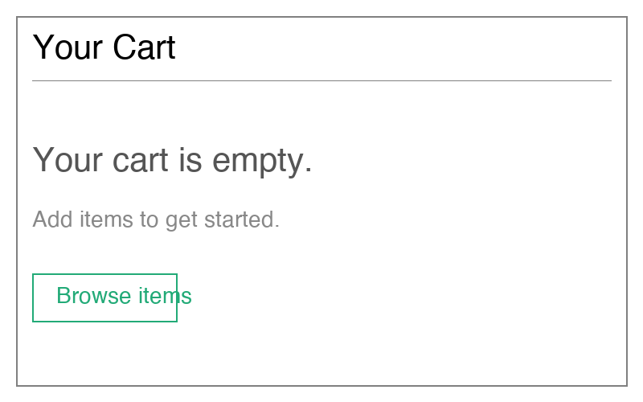

# Quickstart

This walkthrough takes you from install to using Strands Decider as a model
router inside a Strands agent.

## Walkthrough

**1. Install the CLI**

```bash
pip install strands-decider
```

**2. Ask a simple choice question**

```bash
strands-decider ask StrandsAgents/strands-decider-E2B-gemma4-v2-2611 \
  --state "Help! My payouts have been failing for 3 days." \
  --choice "team=billing,technical,sales"
```

<details>
<summary>Sample output</summary>

```
choice_0 -> technical (confidence 0.697)
    technical                0.798
    billing                  0.195
    sales                    0.007
```

</details>

Decider returns the selected option, a probability for every option, and a
confidence score.

**3. Serve the model on a local HTTP server**

```bash
strands-decider serve StrandsAgents/strands-decider-E2B-gemma4-v2-2611 --port 8000
```

**4. Curl the server for a response**

```bash
curl -s localhost:8000/v1/systemone -H 'content-type: application/json' -d '{
  "state": "Help! My payouts have been failing for 3 days.",
  "questions": {
    "team": {
      "type": "choice",
      "instructions": "Which team should handle this?",
      "criteria": {
        "billing": "billing and payments",
        "technical": "bugs and outages",
        "sales": "pre-sales questions"
      }
    }
  }
}'
```

<details>
<summary>Sample output</summary>

```json
{
  "model": "strands-decider-E2B-gemma4-v2-2611",
  "answers": {
    "team": {
      "type": "choice",
      "choice": "billing",
      "probabilities": {
        "billing": 0.8505,
        "technical": 0.1469,
        "sales": 0.0026
      },
      "confidence": 0.7757
    }
  },
  "usage": { "input_tokens": 82, "output_tokens": 1 },
  "latency_ms": 367.92
}
```

</details>

## Ask about an image

v2 Gemma 4 models accept images directly — no extra install or flag needed:

```bash
strands-decider ask StrandsAgents/strands-decider-E2B-gemma4-v2-2611 \
  --state "What is the state of this checkout screen?" \
  --image screen.png \
  --choice "status=paid,retry,cart,empty"
```

<details>
<summary>Sample output</summary>

Run against this empty-cart screenshot:



```
choice_0 -> empty (confidence 0.887)
    empty                    0.915
    cart                     0.081
    paid                     0.003
    retry                    0.001
```

</details>

From the HTTP API, pass base64 images in the `images` field. See
[designs/images](../designs/images.md) for the request shape, limits, and the
vision benchmark results.

## Next steps

Wire Decider into a Strands agent as the decision model: see
[Decision models in the Strands SDK](https://strandsagents.com/docs/user-guide/sdk/decision-models/)
for the SDK getting-started walkthrough.
