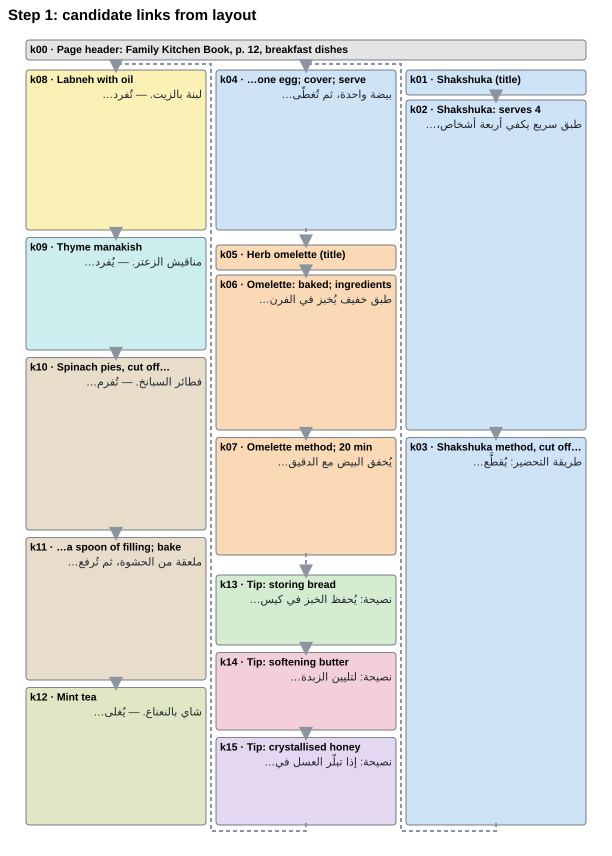
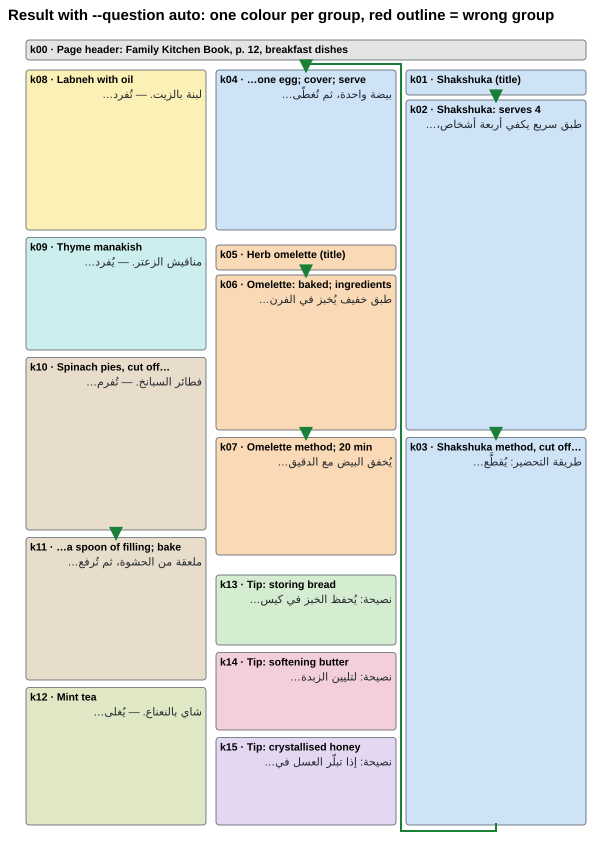

# Grouping OCR text: `noul` to decide, `choice` to rank

**In short:** strands decider has two question types that fit this task. A `noul` is a yes/no
question that returns P(yes); a `choice` picks one of several options (see the
[main README](../../README.md#how-to-start-using-strands-decider)). Use a `noul` to decide
whether a link exists ("does box B continue box A?"), and a `choice` to rank several
candidates. This example shows the difference on a document task.

OCR on a scanned page gives you text boxes, a title here and a paragraph there, but not the
recipes they belong to. Layout tells you where each box is. Strands decider reads the text and
says whether a recipe continues from one box to the next.

| Layout proposes a next box for each box | The decider keeps the real links |
|---|---|
|  |  |

**To see every step with its intermediate results** (the page, the candidates, one request and
answer in full, the score for every pair, and `noul` against `choice`), open
[`walkthrough.ipynb`](walkthrough.ipynb). Its outputs are saved, so it reads on GitHub without
running anything.

```bash
git clone https://github.com/strands-labs/strands-decider && cd strands-decider
pip install -e .
strands-decider serve StrandsAgents/strands-decider-2B-qwen3.5-v1-2610 --port 8099

# in a second terminal, once the server has loaded the model
python examples/ocr_grouping_noul_vs_choice/group_ocr_text.py

# or step by step, in the notebook
pip install notebook
jupyter notebook examples/ocr_grouping_noul_vs_choice/walkthrough.ipynb
```

The script uses only the Python standard library. It expects a server on port 8099 unless
`STRANDS_DECIDER_URL` is set, and refuses any address that is not `http://` or `https://`.
A run asks 14 questions and takes a few seconds once the model is loaded (longer on CPU). The
notebook also needs Jupyter, and draws its pictures with `draw.py`.

## The page

`arabic_cookbook.json` is a synthetic page from an invented Arabic family cookbook, read right
to left in three columns. It has 16 boxes: a page header (labelled `null`, no recipe) and 9
hand-labelled recipes and tips. It was written for this example and includes a few traps:

- a recipe whose steps continue at the top of the next column (to the left, since it's Arabic)
- a paragraph that the OCR split in the middle of a sentence
- a second egg dish directly under the end of the first
- three short kitchen tips stacked one under another, each its own item

Each box has an `id`, a `bbox` of `[x0, y0, x1, y1]` in pixels, its `text`, and the
hand label `recipe`, which the script uses only to score its output. The ids are not in
reading order. `--page` takes another file in the same format. Set `page.direction` to `"rtl"`
or `"ltr"` (the default is `"ltr"`), and tune `MAX_GAP` at the top of the script to the scale
of your scans.

## How it works

1. **Layout proposes.** For each box, the candidate is the box directly below it in the same
   column, or, if nothing is below, the top of the next column (or several tops, if that
   column has gaps). The page header lies over
   several columns, belongs to no recipe, and is left out.
2. **The decider judges.** Each request sends a *state*, the text the model reads, and one
   question. For a `noul`, the state holds the end of one box, one line of layout context and
   the start of the next box, and the answer is P(true). For a `choice`, the candidates go
   into the options, and the answer is one probability per option.
3. **Code settles the links.** Links are accepted strongest first, and a link that would
   close a loop is skipped. Each box gets at most one next box and at most one previous box,
   and the links chain into recipes.

A run prints each group of box ids and whether it matches a labelled recipe:

```text
ok = matches a labelled recipe, xx = does not, -- = not part of any recipe

ok k01 k02 k03 k04  شكشوكة
ok k05 k06 k07      عجة الأعشاب
ok k13              نصيحة: يُحفظ الخبز في كيس
...
-- k00              كتاب المطبخ العائلي — الصفحة

9/9 recipes match the labels (auto questions)
```

## `noul` to decide, `choice` to rank

Each question can carry *criteria*: short texts that say what each answer means. A `noul` has
two, `true` and `false` (here, `SAME` at the top of the script). Its probability is the
model's share for `true` against `false`, for the one pair it was asked about. A `choice` is
one softmax over all the options you supply, so each value is a share of the total. A `none`
option is scored like any other option string.

So by default the script uses a `noul` to decide whether a link exists. When a box has several
candidates, it first asks a `choice` to rank them, without `none`, and then a `noul` about the
top one. On this page every box has at most one candidate, so the default run asks only `noul`
questions. `--question choice` instead asks a `choice` that also decides, with `none` as an
option and the top option kept unless it is `none` (`none` also wins a tie). Here that means
one candidate against `none`:

```bash
python examples/ocr_grouping_noul_vs_choice/group_ocr_text.py                    # 9/9 recipes
python examples/ocr_grouping_noul_vs_choice/group_ocr_text.py --question choice  # 6/9 recipes
```

With `strands-decider-2B-qwen3.5-v1-2610`, the `choice` run misses the link from the recipe
title to its text and the jump to the next column, and links two separate recipes. In our
reading, the model is weighing a concrete text against an abstract `none`. Adding the `noul`'s
two criteria to the `choice` (the `true` text to its instructions, the `false` text to `none`)
still gives 6/9.

The criteria wording matters as much. The `false` criterion names what starts a new item on
this page: a dish name followed by a full stop or a dash, or the word نصيحة (tip). With the
generic "B starts a different recipe, a new title, or a separate tip." the default run rebuilds
only 5 of 9, fewer than the `choice` run. So the `noul` wins here once its criteria fit the
page. This example answers
[issue #132](https://github.com/strands-labs/strands-decider/issues/132), which asked for an
example where, with a single candidate, a `noul` beats a "this or none" `choice`.

> This example is an illustration rather than a benchmark: one synthetic page, with questions,
> criteria and thresholds tuned by hand to it. Every accepted link scores between 0.54 and
> 0.86, and the closest rejected link scores 0.47, so treat the links as proposals to check,
> not as decisions (see the
> [routing convention](../../docs/architecture.md#the-routing-convention)).
